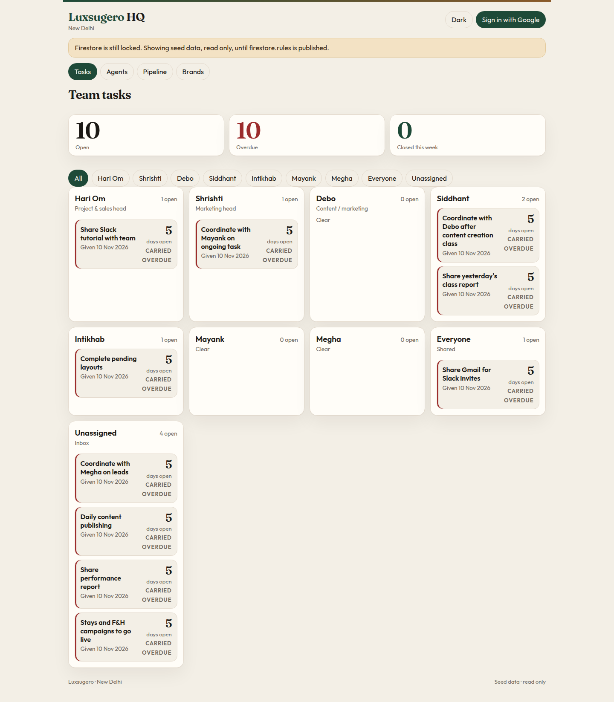

# Luxsugero HQ

One dashboard for Luxsugero Stays, Luxskybox, Forest & Hills, and Braj Murliwala.

Anyone with the link can view. Only the verified Google account `luxsugerostudios@gmail.com` can edit. That lock is enforced in [`firestore.rules`](firestore.rules), not only in the UI.

Live site, once GitHub Pages is enabled: <https://luxsugerostudios.github.io/Luxsugero-hq/>

The Firebase web config in [`src/firebaseConfig.ts`](src/firebaseConfig.ts) is the public client config for project `luxsugero-hq`. It is safe to commit. It is not a service-account key.

Until `firestore.rules` is published, Firestore is in production mode (default deny). The site still renders **seed data, read only**, and says that Firestore is locked.



## Screens

Tasks, agents, pipeline, and brands. Big counts first. Open tasks older than 3 days are marked **OVERDUE**. Days are calendar days in Asia/Kolkata.

Public lead cards show an anonymous code (`SKY-PT-01`), stage, hot/warm/cold, and days since last contact. Names, sources, emails, and phones are not on those cards.

## 1. Publish Firestore rules

The rules file is self-contained. Paste the whole file, then publish. Do this before expecting the live site to read or write Firestore.

1. Open [Firebase console](https://console.firebase.google.com/) → project **luxsugero-hq**.
2. **Firestore Database** → **Rules**.
3. Replace the default deny rules with the full contents of [`firestore.rules`](firestore.rules).
4. **Publish**.

Or, with the Firebase CLI, from this repo:

```bash
npx firebase-tools deploy --only firestore:rules,firestore:indexes --project luxsugero-hq
```

The app uses the **default** database in **asia-south1**. No composite indexes are required. [`firestore.indexes.json`](firestore.indexes.json) is an empty set so a CLI deploy does not invent indexes.

Google sign-in is already enabled, and `luxsugerostudios.github.io` is already an authorized domain. For sign-in on your laptop, also add `localhost` under **Authentication → Settings → Authorized domains**.

What the rules do:

- `people`, `tasks`, `agents`, `brands`, and `leads` are world-readable.
- Writes on those collections require `request.auth.token.email == 'luxsugerostudios@gmail.com'` and `request.auth.token.email_verified == true`.
- Public `leads` documents cannot contain name, email, phone, source, or price fields.
- `directives` (founder instructions to agents) are readable and writable only by that account.
- `private/vault/leads/{code}` (real lead name, source, note, email, phone) is readable and writable only by that account. The whole `private` tree is founder-only.

## 2. Enable GitHub Pages

1. On GitHub, open **luxsugerostudios/Luxsugero-hq → Settings → Pages**.
2. Under **Build and deployment**, set **Source** to **GitHub Actions**.
3. Merge this project to `main`.

[`.github/workflows/pages.yml`](.github/workflows/pages.yml) runs on every push to `main`: test, seed check, `npm run build`, then deploy `dist/` to Pages. The Vite `base` is `/Luxsugero-hq/`, which matches the project-site URL.

The first run creates the `github-pages` environment. If the environment asks for approval, approve it once.

## 3. Load the seed

The Admin SDK bypasses security rules, so you can load data before or after publishing rules. Viewers only see it after the rules allow public read.

1. Firebase console → **Project settings → Service accounts → Generate new private key**.
2. Save the JSON **outside this repo**. Never commit it.
3. From the repo root:

```bash
npm install
export GOOGLE_APPLICATION_CREDENTIALS=/absolute/path/luxsugero-hq-bot.json
node scripts/push-data.mjs seed/seed.json
```

`FIREBASE_PROJECT_ID` defaults to `luxsugero-hq`.

Check a file without writing:

```bash
node scripts/push-data.mjs --dry-run seed/seed.json
```

### Private lead identities

Real names and sources stay out of git. The public repo only has fake contacts in [`seed/private.seed.example.json`](seed/private.seed.example.json).

```bash
cp seed/private.seed.example.json seed/private.seed.json
# edit seed/private.seed.json locally, then:
node scripts/push-data.mjs seed/private.seed.json
```

`seed/private.seed.json` is gitignored.

## 4. How the HQ bot refreshes data

Each morning the bot writes a JSON file in the shape below and runs:

```bash
export GOOGLE_APPLICATION_CREDENTIALS=/absolute/path/luxsugero-hq-bot.json
node scripts/push-data.mjs /absolute/path/today.json
```

Behavior:

- Upsert by id (`merge: true`). Fields you omit are left as they are. Arrays you send replace the whole array.
- Records missing from the file are **not** deleted.
- `"_delete": true` on a record deletes that document. Example: `{ "id": "task-old", "_delete": true }`.
- The script refuses public leads that carry a name, source, email, phone, or price, and refuses emails or currency in public text.
- It prints counts only. It does not print names or directive text.
- Directive replies go in `directives` (`queued` → `picked_up` → `done`, plus optional `response`). That collection is founder-only.
- Lead identity goes only under `private.leads`.

Partial morning file:

```json
{
  "agents": [
    {
      "id": "pm-skybox",
      "focus": "Follow the warm pipeline",
      "updatedAt": "2026-11-16T04:30:00.000Z"
    }
  ],
  "brands": [
    {
      "id": "skybox",
      "headlines": [
        { "label": "Warm leads", "value": "6" },
        { "label": "Deposits", "value": "0" }
      ]
    }
  ],
  "directives": [
    {
      "id": "directive-id",
      "status": "picked_up",
      "response": "Started",
      "updatedAt": "2026-11-16T05:00:00.000Z"
    }
  ]
}
```

Do not put customer names, emails, phones, or prices in `people`, `tasks`, `agents`, `brands`, or `leads`. Agent focus, task titles, and brand headlines are public.

## Firestore collections

Dates in public docs are strings: `YYYY-MM-DD` or an ISO timestamp ending in `Z`. The client sorts in the browser.

### `people/{id}`

Public read, founder write.

```json
{ "id": "hari-om", "name": "Hari Om", "role": "Project & sales head", "order": 1 }
```

Ids: `hari-om`, `shrishti`, `debo`, `siddhant`, `intikhab`, `mayank`, `megha`, `everyone`, `unassigned`.

### `tasks/{id}`

Public read, founder write.

```json
{
  "id": "task-slack-tutorial",
  "title": "Share Slack tutorial with team",
  "ownerId": "hari-om",
  "givenDate": "2026-11-10",
  "dueDate": null,
  "status": "open",
  "closedAt": null,
  "longTerm": false,
  "flagAfterDays": null,
  "createdAt": "2026-11-10T04:30:00.000Z",
  "updatedAt": "2026-11-10T04:30:00.000Z"
}
```

`status` is `open` or `done`. `closedAt` is set when a task is marked done. `longTerm` and `flagAfterDays` are optional. Overdue means the task is open and the Asia/Kolkata calendar days since `givenDate` are greater than `flagAfterDays` when that number is set, otherwise 3. A long-term task (`longTerm: true`, usually `flagAfterDays: 7`) shows a Long-term badge. Carried means open and the given date is before today.

### `agents/{id}`

Public read, founder write.

```json
{
  "id": "hq-main",
  "name": "HQ Main Manager",
  "group": "HQ",
  "focus": "Awaiting first sync",
  "waitingOnFounder": [],
  "updatedAt": "2026-11-10T04:30:00.000Z",
  "order": 1
}
```

`group` is `HQ`, `Brand PM`, or `Department`.

### `brands/{id}`

Public read, founder write. Ids: `skybox`, `stays`, `fh`, `braj`.

```json
{
  "id": "fh",
  "name": "Forest & Hills",
  "short": "F&H",
  "status": "founder-led",
  "summary": "Plotted land near Dehradun",
  "url": null,
  "headlines": [
    { "label": "Pipeline", "value": "0" },
    { "label": "Mode", "value": "On ask" }
  ],
  "waitingOnFounder": ["Agents act only on founder ask"],
  "order": 3
}
```

`status` is `active`, `paused`, or `founder-led`. Headline values are short public strings, not prices.

### `leads/{code}`

Public read, founder write. Anonymous. Code shape: `SKY-PT-01` (prefix `SKY` / `STY` / `FNH` / `BRJ`, ISO country, running number).

```json
{
  "code": "SKY-PT-01",
  "brand": "skybox",
  "stage": "meet_booked",
  "temperature": "hot",
  "country": "PT",
  "lastContactAt": "2026-11-14",
  "createdAt": "2026-11-10T04:30:00.000Z",
  "updatedAt": "2026-11-14T04:30:00.000Z"
}
```

`stage`: `new`, `contacted`, `meet_booked`, `proposal`, `deposit`, `won`, `lost`.

`temperature`: `hot`, `warm`, `cold`.

`brand`: `skybox`, `stays`, `fh`, `braj`.

### `directives/{id}`

Founder read and write only. Viewers never receive this collection.

```json
{
  "id": "3f1c1a0e-7b2d-4e5a-9c11-0a0b0c0d0e0f",
  "agentId": "pm-skybox",
  "text": "Send the founder a one-line status.",
  "status": "queued",
  "response": null,
  "createdAt": "2026-11-15T12:00:00.000Z",
  "updatedAt": "2026-11-15T12:00:00.000Z"
}
```

`agentId` is an agent id or `"all"`. `status` moves `queued` → `picked_up` → `done`.

### `private/vault/leads/{code}`

Founder read and write only. This is the stored form of a private lead. Firestore paths alternate collection and document, so `vault` is the parent document and `leads` is the subcollection.

Client path: `doc(db, "private", "vault", "leads", code)`.

```json
{
  "code": "SKY-PT-01",
  "name": "Sample Contact A",
  "source": "Sample form",
  "note": "Sample meeting note",
  "country": "Portugal",
  "email": "",
  "phone": ""
}
```

The signed-in founder sees these fields on the lead card. Public viewers do not.

## Local development

```bash
npm install
npm test
npm run dev
```

Open <http://127.0.0.1:5173/Luxsugero-hq/>.

`npm run build` typechecks and writes `dist/`. If `src/firebaseConfig.ts` is put back to `YOUR_*` placeholders, the app does not call Firebase and stays on seed data.

## Input JSON for `scripts/push-data.mjs`

Top-level keys, all optional: `people`, `tasks`, `agents`, `brands`, `leads`, `directives`, `private`.

`private` may only contain `leads`.

Unknown keys are rejected. A file with nothing to write is an error.
